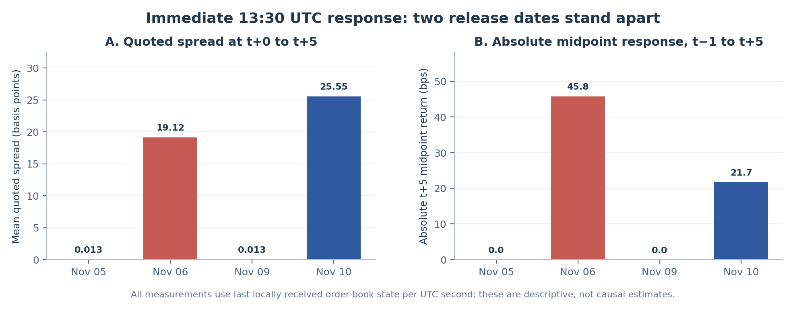
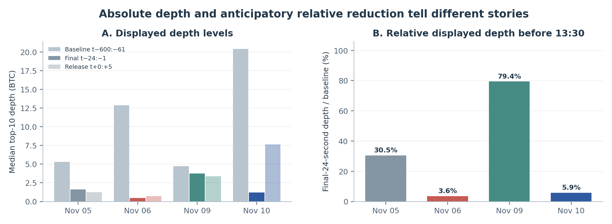

# Kraken BTC/USD: Macroeconomic-Event Liquidity Dynamics

**Independent exploratory research working paper · November 2026**

**[Working paper (PDF)](paper/WORKING_PAPER.pdf)** · **[Manuscript](paper/WORKING_PAPER.md)** · **[Five figures](figures/)** · **[Aggregate results](results/)** · **[Data-availability policy](docs/DATA_AVAILABILITY.md)**

## Research question

How do displayed BTC/USD order-book spreads, top-10 depth, and midquotes change around scheduled U.S. economic announcements relative to a candidate same-clock non-release control?

The project studies **four 13:30 UTC sessions**: Nov 5 (productivity), Nov 6 (employment), Nov 9 (control candidate), and Nov 10 (simultaneous CPI and Real Earnings). The author's Azure research pipeline reports **2,761,064 independently checksum-validated, reconstructed book updates** across the four event-containing segments. Full empirical replay requires original data retained privately.

| Session | Initial mean quoted spread (bps) | Median top-10 depth (BTC) | Absolute t+5 midpoint move (bps) | Pre-event median depth reduction |
|:--|--:|--:|--:|--:|
| Nov 05 · Productivity | 0.0126 | 1.2545 | 0.00 | 69.5% |
| Nov 06 · Employment | 19.1198 | 0.7079 | 45.78 | 96.4% |
| Nov 09 · Control | 0.0134 | 3.3989 | 0.00 | 20.6% |
| Nov 10 · CPI + Real Earnings | 25.5456 | 7.6236 | 21.72 | 94.1% |



The immediate spread and midpoint responses differ substantially on Nov 6 and Nov 10 versus the control, **but not on Nov 5**. Absolute post-release displayed depth is **not** consistently lower than on the control. All four dates have complete required primary-second coverage, but Nov 5 and 6 have later data gaps. These are descriptive observations from **three release days and one candidate control**, not event-level statistical proof, causal evidence, or demonstrated trading profitability.

## Research methodology and freeze chronology

- Kraken WebSocket v2 BTC/USD aggregated Level 2, 100 displayed levels each side; Kraken CRC32 checks the best 10 levels only.
- Last reconstructed order-book state **received** in each UTC second; not an exchange-clock-synchronized quote.
- Primary metrics: mean spread, median displayed top-10 depth and absolute 5-second midpoint log return. Secondary: final-24-second depth ratio relative to an earlier baseline.
- The fixed analysis protocol was committed **before** the Nov 9 and Nov 10 recordings. This public repository preserves the original frozen commit [`fc51959`](https://github.com/juderamcharitar/kraken-btc-macro-event-liquidity/commit/fc51959aba9e4c242547f6001ebb3058dc6b71c3) dated Nov 9, 2026 at 00:55 UTC, followed by a distinct sanitized-publication commit. The Nov 5 and Nov 6 sessions were explored before the protocol freeze.
- No within-day reference-window ranks are presented as independent event-level p-values. The Nov 9 control's interpretation after 13:40 UTC is limited by a separate Fed event, and CPI cannot be isolated from simultaneous Real Earnings.



## Reproduction: what is and is not possible

The public code contains the collector, CRC32 validator, replay scripts, pre-frozen protocol and statistical analysis, plus synthetic tests. **Machine-readable second-level observations, event reports, detailed audit CSVs, and raw Kraken L2 recordings are withheld from this public edition pending redistribution review.** The source data and detailed provenance are retained in the private research archive, not destroyed.

Reproduce the public **synthetic checks and aggregate consistency checks**:

```bash
python3 -m unittest -v test_project3_statistical_analysis_v2.py
python3 scripts/check_published_metrics.py
sha256sum -c project3_protocol_hashes_2026-11-08.sha256
```

The primary empirical analysis requires the original inputs. The frozen `PROJECT3_FRAMEWORK_README.md` retains the workflow, but its data-dependent replay command cannot run on this distribution alone. Plotted second-by-second trajectories in Figures 3–4 likewise cannot be independently regenerated from the aggregate files.

## Repository layout

- `paper/` — public summary-edition PDF and Markdown source.
- `figures/` — five research figures, both PNG and PDF versions.
- `results/` — aggregate four-date case metrics and single-control contrasts.
- `docs/` — source/reproducibility scope, data policy, security audit notes.
- `scripts/` — public summary verification.
- Root `.py` files and frozen protocol — original research implementation, tests, and dated source hashes.

## Data rights and scientific caution

Data sourced from the Kraken Spot WebSocket API. Public API access is **not** blanket redistribution permission. Kraken states that some uses, including non-personal commercial market-data use, require prior permission: [API policy](https://docs.kraken.com/api/docs/guides/global-intro/). Review and seek permission at **marketdata@kraken.com** before releasing underlying recordings or machine-readable per-second derived series for broader use.

This is independent exploratory work, not peer reviewed, not a trading strategy, and not investment advice. **No open-source software license is granted by default**; contact the author for reuse permissions.
