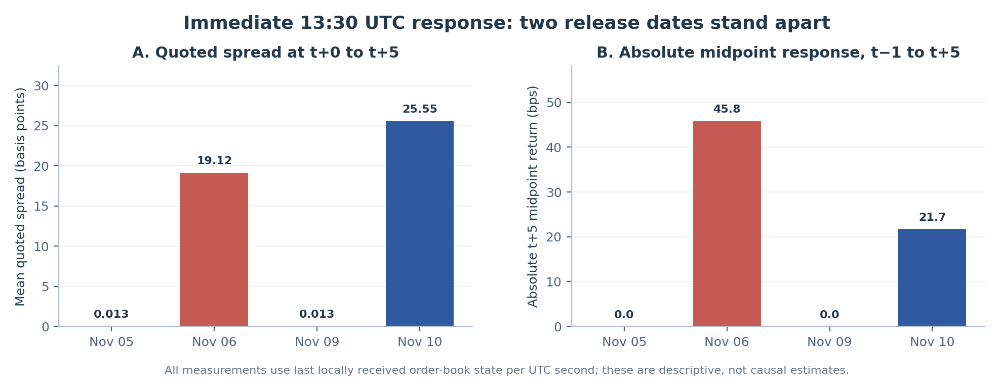
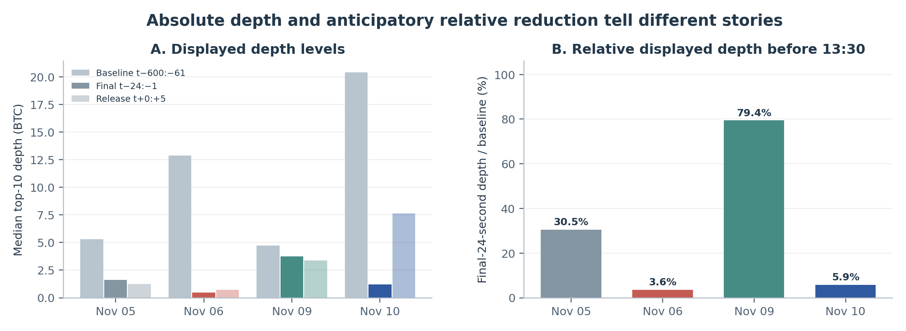
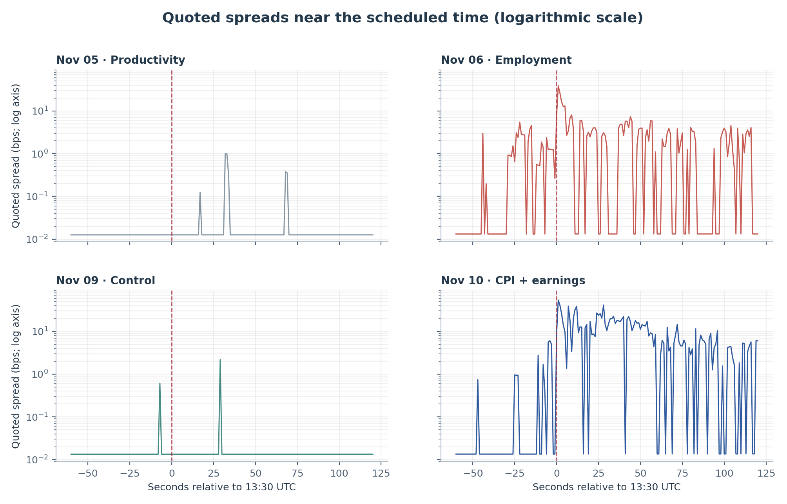
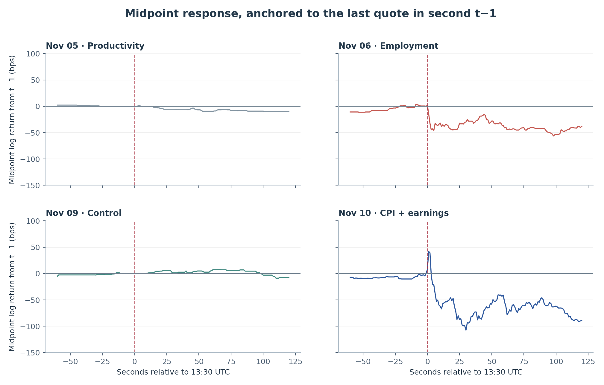
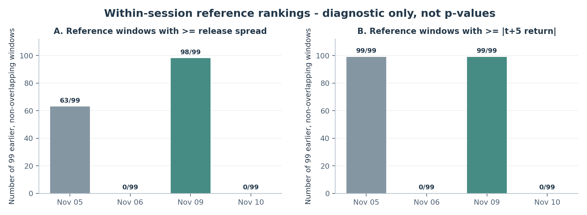

> **Public distribution scope (v1.1):** This edition excludes downloadable raw and per-second Kraken market data. The reported statistics and figures are retained; reproducing the empirical event study requires the separately retained private inputs. The paper remains exploratory and not peer reviewed.

> **Research status:** Exploratory observational working paper, not peer reviewed. The 5 and 6 November measurements informed design choices and are retrospectively analyzed. The 9 and 10 November sessions were collected after the fixed protocol was committed to GitHub. This paper does **not** claim causal identification, statistical generalizability, execution-ready profitability, or news-surprise identification.

## Abstract

This study characterizes how Kraken BTC/USD displayed order-book liquidity and midpoint quotations evolve around U.S. economic announcements at 13:30 UTC. Using a WebSocket v2 depth-100 book collector, we examine four one-hour event-containing segments (5, 6, 9 and 10 November 2026) containing **2,761,064 validated recorded updates**. Our pre-frozen analysis focuses on mean best-quote spread, median combined top-ten-level depth and absolute midpoint log return over the six receipt-second buckets t+0 through t+5, with a candidate same-clock non-release control on 9 November. All four sessions pass the specified primary data-coverage criteria. On 6 November (employment) and 10 November (simultaneous CPI and Real Earnings), the mean initial spreads are **19.12** and **25.55 basis points**, versus **0.0134** on the 9 November control; five-second absolute midpoint returns are **45.78** and **21.72 basis points**, versus zero on the control. The 5 November productivity session displays neither broadening nor immediate midpoint movement. Median top-ten depth on 10 November is higher in absolute terms than on the control despite substantial within-day pre-event depth withdrawal. These contrasts are descriptive: three release dates and one candidate control do not support event-level significance tests or causal claims. The study documents a 39-second missing interval after the primary window on 6 November and explicitly limits longer-horizon interpretation.

**Keywords:** cryptocurrency market microstructure; limit order book; macroeconomic announcements; displayed liquidity; event study; data integrity; spread; depth.

## 1. Research question and design

The question is whether displayed liquidity and midpoint response at the scheduled instant of an economic release differ from a matched-clock, non-release observation. Unlike an order-execution study, the outcome concerns **posted market depth and quotes**, not realized fills. The fixed protocol identifies four quantities:

1. **H1 - quoted spread:** mean best ask minus best bid, normalized in basis points, in seconds t+0 to t+5 is higher on release dates than on the control.
2. **H2 - quoted depth:** median total size across the best ten bid and ten ask price levels in t+0 to t+5 is lower on release dates than on the control.
3. **H3 - midpoint response:** absolute log change from the last observed midpoint in t-1 to the last observed midpoint in t+5 is larger on release dates.
4. **H4 - anticipatory depth (secondary):** the ratio of median combined top-ten depth over t-24 to t-1 to median depth over t-600 to t-61 is lower on release dates.

The 5 and 6 November recordings had already been inspected when these hypotheses and gates were selected. The protocol was stored in Git commit [`fc51959`](https://github.com/juderamcharitar/kraken-btc-macro-event-liquidity/commit/fc51959aba9e4c242547f6001ebb3058dc6b71c3) at **00:55:44 UTC on 9 November 2026**, before the two subsequent automated recordings. Therefore, results from the later sessions are prospectively processed under a precommitted specification, but this is **not** an independently registered or fully blinded experiment.

The November 9 control is a *candidate*, not a definitive counterfactual. The Federal Reserve calendar lists a Michelle Bowman discussion for **08:40 ET / 13:40 UTC**, i.e. t+600 relative to the control anchor; comparisons after that boundary are unsuitable as uncontaminated controls. The Bureau of Labor Statistics lists the 5 November Productivity and Costs, 6 November Employment Situation, and simultaneous 10 November CPI and Real Earnings publications at 08:30 ET / 13:30 UTC [1, 2]. CPI-specific attribution on the 10th is impossible with these data because Real Earnings was released at the same time.

## 2. Data, synchronization and integrity

Kraken WebSocket v2 provides a top-of-book and aggregated-level feed with subscriptions up to 100 levels per side used here. Each separately initialized segment begins with a snapshot, followed by incremental updates. The exchange's CRC32 digest covers the **best ten levels**, not all 100 [3]. We treat successive recorder segments as separate state reconstructions and do not bridge a disconnect with stale book state.

Analysis aligns book states using **local UTC receipt time**, not an externally synchronized exchange-event clock. Within each observed UTC second, the last reconstructed received quote becomes that second's observation. An observed quiet second can be absent rather than imputed. Consequently, the gap between the last pre-13:30 and first post-13:30 update is a message-spacing statistic, **not a measured exchange or network latency**.

| Date | Book updates validated and replayed | Seconds observed in [-600, +900] | Boundary-message gap (ms) | Primary eligible |
|:--|--:|--:|--:|:--:|
| Nov 05 | 464,019 | 1,500 / 1,501 | 77.611 | Yes |
| Nov 06 | 968,004 | 1,462 / 1,501 | 48.475 | Yes |
| Nov 09 | 557,074 | 1,501 / 1,501 | 124.964 | Yes |
| Nov 10 | 771,967 | 1,501 / 1,501 | 27.372 | Yes |

The reported full-audit checks for all four event-containing segments establish zero CRC mismatches, no crossed-book failures, no backward receipt-timestamp jumps and matching recorded/replayed update counts. The detailed audit CSVs and raw WebSocket recordings are held in the private research archive and are **not distributed** with this public summary edition. All four full-audit outcomes were recorded on the original Azure VM and summarized in this paper; an external reader cannot independently repeat the raw-recording audit from the public distribution.

The 95%-coverage baseline and final-minute thresholds are met on every date, and seconds t-1 through t+5 are all observed. Missing seconds later in the analysis interval are: **t+685** on 5 November; **t+264 to t+302** inclusive on 6 November; none on 9 or 10 November. Every case has a complete observed path through t+120. Reconstruction after a long, unexplained feed silence is not treated as proof of a continuously observed 100-level book.

## 3. Pre-specified measurements

Let $B_t$ and $A_t$ be the best bid and ask in the last received book state within second $t$, and let $M_t=(A_t+B_t)/2$. Denoting the summed displayed quantities at the best ten bid and ten ask levels by $Q^{bid}_{10,t}$ and $Q^{ask}_{10,t}$, we use

$$
S_t = 10^4\frac{A_t-B_t}{M_t}, \qquad D_t = Q^{bid}_{10,t}+Q^{ask}_{10,t}.
$$

The primary spread is the arithmetic mean of $S_t$ over t=0,...,5; primary depth is the median of $D_t$ over those six seconds; the five-second midpoint response is

$$
R_5 = 10^4\log\!\left(\frac{M_5}{M_{-1}}\right), \qquad H3=|R_5|.
$$

The secondary anticipatory ratio is

$$
H4 = \frac{\operatorname{median}_{t=-24,\ldots,-1}D_t}{\operatorname{median}_{t=-600,\ldots,-61}D_t}.
$$

The study also ranks each first-six-second measurement against **99 non-overlapping six-second reference windows** in the previous ten minutes of the same recording. These windows are internally dependent and selected from one session, so their relative ranks are **not** inferential p-values. The basic eligibility gate requires independent all-update CRC verification for the event-containing segment, exact event-clock alignment, at least 95% observed seconds in the two specified pre-event ranges, and complete receipt-second coverage over t-1,...,+5. No missing-second forward filling is performed.

## 4. Results

### 4.1 Primary and anticipatory measurements

| Session | Mean spread (bps), t+0:+5 | Median top-10 depth (BTC), t+0:+5 | Abs. return (bps), t+5 | Pre-24s depth change vs baseline |
|:--|--:|--:|--:|--:|
| Nov 05 — Productivity | 0.0126 | 1.2545 | 0.00 | -69.5% |
| Nov 06 — Employment | 19.1198 | 0.7079 | 45.78 | -96.4% |
| Nov 09 — Control | 0.0134 | 3.3989 | 0.00 | -20.6% |
| Nov 10 — CPI + earnings | 25.5456 | 7.6236 | 21.72 | -94.1% |

{width=94%}

The employment and CPI/Real Earnings sessions exhibit notably wider initial quotes than the control, with mean quoted spread differences of **+19.106** and **+25.532 basis points**, respectively. Their five-second absolute midpoint responses exceed the control by **45.78** and **21.72 basis points**. The productivity session instead shows a slightly *narrower* spread than the control and no immediate midpoint response. H1 and H3 therefore have **mixed day-level evidence**: salient positive contrasts on two releases, but not a universal release response.

H2 is also mixed. The productivity and employment sessions have smaller release-window median top-ten displayed depth than the control (1.2545 and 0.7079 BTC versus 3.3989 BTC). Yet the CPI/Real Earnings session has **7.6236 BTC**, more than twice the control level. Absolute displayed depth is influenced by day-specific market conditions, and the one-day control does not isolate an announcement effect.

{width=94%}

The secondary H4 ratio is 0.3050 (5 November), 0.0358 (6 November), and 0.0588 (10 November), compared with 0.7944 for the control. Put differently, the reduction in final-24-second median depth versus the earlier within-day baseline is about **69.5%, 96.4%, and 94.1%** on the three release dates, versus **20.6%** on 9 November. The particularly large reductions for employment and CPI/Real Earnings are compatible with an anticipatory liquidity-withdrawal interpretation; the observational design cannot establish who withdrew liquidity, why, or whether the pattern persists beyond these dates.

### 4.2 Event-time trajectories

{width=94%}

{width=94%}

At 10 November t+1, the midpoint is approximately **+41.89 bps** above the t-1 anchor; by t+5 it is **-21.72 bps** and by t+30 it is **-107.43 bps**. These are changes in **midquotes**, not executable prices. The observed reversal is descriptive and cannot distinguish reactions to CPI from reactions to the simultaneous Real Earnings release, independent news, or other order-flow effects.

| Date | Signed midpoint t+5 (bps) | t+30 | t+60 | t+120 |
|:--|--:|--:|--:|--:|
| Nov 05 | +0.00 | -5.69 | -9.46 | -9.74 |
| Nov 06 | -45.78 | -29.80 | -40.79 | -38.31 |
| Nov 09 | +0.00 | +1.38 | +5.53 | -7.23 |
| Nov 10 | -21.72 | -107.43 | -54.02 | -89.07 |

All four cases have a complete receipt-second path through +120 seconds. The report does not use post-gap November 6 book states to claim a continuous response several minutes after the release. The control's 13:40 UTC Federal Reserve discussion is an additional reason to avoid event-isolating claims for t+600 and later on November 9.

### 4.3 Within-session references

| Date | Earlier windows with spread >= first-six-second spread | Earlier windows with depth <= first-six-second depth | Earlier windows with abs. midpoint response >= first-six-second response |
|:--|--:|--:|--:|
| Nov 05 | 63 / 99 | 5 / 99 | 99 / 99 |
| Nov 06 | 0 / 99 | 4 / 99 | 0 / 99 |
| Nov 09 | 98 / 99 | 19 / 99 | 99 / 99 |
| Nov 10 | 0 / 99 | 5 / 99 | 0 / 99 |

{width=94%}

On both 6 and 10 November, **zero of 99** prior reference windows were as extreme as the measured release-time spread and absolute t+5 return. On the 5 November productivity date, 63/99 reference windows met or exceeded the release spread and 99/99 met or exceeded the zero absolute return. These descriptive comparisons contextualize event-time behavior without treating the previous seconds as independent macroeconomic experiments.

## 5. Hypothesis assessment

| Hypothesis | Four-session descriptive finding | Assessment |
|:--|:--|:--|
| H1, wider spreads | Clear widening on Nov 6 and Nov 10; not Nov 5 | **Mixed, not confirmed** |
| H2, lower absolute release depth | Lower than control on Nov 5 and Nov 6; *higher* on Nov 10 | **Mixed, contradicted on one release** |
| H3, greater abs. t+5 return | Stronger on Nov 6 and Nov 10; zero on Nov 5 and control | **Mixed, not confirmed** |
| H4, lower pre-24s / baseline depth ratio | Lower ratio on all three releases than on the sole control | **Consistent descriptively; untested statistically** |

The two large-release observations make the book-level phenomenon worth further sampling, while the null productivity response and contrary absolute-depth result bound any generalization. No causal effect size, inferential confidence interval, multiple-testing correction or statistical significance test is reported because **the number of independent event/control dates is insufficient**.

## 6. Robustness, reproducibility and limitations

**Data fidelity.** All four cases pass the stated event-segment all-update audit and equal-count replay checks recorded in the supplied analysis reports. The checksum only constrains the best ten levels and cannot prove perfect capture of all events or reconstruct missing updates across a quiet interval. Local receive timestamps were NTP-synchronized on the VM but not independently calibrated to sub-second exchange/announcement latency.

**Study design.** This is one exchange and one instrument over four calendar dates. Nov 9 is a single same-clock control with an independently scheduled Federal Reserve discussion at +600 seconds. Market regimes, differences in baseline depth, unrelated headlines and simultaneous announcements are not controlled for. The Nov 10 event cannot be attributed uniquely to CPI. No contemporaneous analyst consensus, actual-versus-expected release-surprise series or revision history is used.

**Microstructure interpretation.** The feed is aggregated L2 data, not order IDs or queue positions. Posted depth can disappear, can be non-executable at the analyzed quantities and cannot be equated with actual liquidity consumption. Changes in midpoint omit realized trade prices, fees, spread crossing, slippage, queue priority and latency. The study makes no alpha or backtested-P&L claim.

**Reproducibility boundary.** This **public summary edition** distributes the frozen algorithms, their synthetic tests, aggregate case metrics, descriptive control contrasts, and research figures, but intentionally withholds the machine-readable per-second market series, event reports, detailed audit CSVs, and raw exchange-message recordings pending a separate market-data redistribution review. Consequently, the public package supports source inspection, protocol hash checks, synthetic-test execution, and verification of the published aggregate summary; it does **not** support rerunning the four empirical event studies without access to the original private inputs. The original private archive retains these inputs. Synthetic tests do not substitute for raw-data reproduction.

**Next inferential phase.** Before formal tests, freeze an expanded design with multiple independent release and screened control days; match by time, weekday and market regime where possible; compute uncertainty by **day/event**, not by order-book messages or within-day seconds; and define multiplicity controls (for example Holm adjustment over H1–H3). Additional descriptive sensitivity checks should be labeled as secondary rather than replacing the present frozen endpoints.

## 7. Conclusion

In two of three scheduled U.S. macroeconomic-release recordings, Kraken BTC/USD displayed substantial immediate widening of quoted spreads and relatively large short-horizon midpoint movements compared with one matched-clock control. The third release exhibited neither. Within-day displayed top-ten depth contracted sharply immediately before all three release times relative to earlier baselines, but absolute post-release displayed depth was not consistently lower than on the control day. All cases pass the specified primary data-integrity and receipt-second coverage gates, although two exploratory recordings contain later missing seconds. The evidence supports **further, preregistered multi-event study of anticipatory liquidity withdrawal and quote dislocation**, not causal or profitable-trading conclusions.

## Appendix A. Data gaps and case chronology

- **Nov 05:** one absent receipt-second bucket, t+685; no impact on primary outcome. Initial event boundary message spacing: **77.611 ms**.
- **Nov 06:** 39 consecutive absent receipt-second buckets, t+264 through t+302. The underlying receive-time message gap was approximately 40 seconds; all primary and through-120-second observations were complete. Initial boundary spacing: **48.475 ms**.
- **Nov 09 control:** no missing receipt-second bucket within the [-600,+900] interval. Boundary spacing: **124.964 ms**.
- **Nov 10 CPI + Real Earnings:** no missing receipt-second bucket within the [-600,+900] interval. Boundary spacing: **27.372 ms**.

These boundary spacings are not end-to-end latencies. All raw `*.partial` fragments outside the selected complete event-containing segments remain excluded from the primary paper.

## Appendix B. Reproduction and public-data scope

The public research repository at [https://github.com/juderamcharitar/kraken-btc-macro-event-liquidity](https://github.com/juderamcharitar/kraken-btc-macro-event-liquidity) preserves the **original 9 November frozen-methodology commit** with the same Git SHA (`fc51959aba9e4c242547f6001ebb3058dc6b71c3`). It includes the collector, CRC32 validator, event replay code, locked analysis code, and synthetic unit tests. The public summary can be checked without redistribution of Kraken's machine-readable time-series data:

```bash
python3 -m unittest -v test_project3_statistical_analysis_v2.py
python3 scripts/check_published_metrics.py
sha256sum -c project3_protocol_hashes_2026-11-08.sha256
```

The empirical replay commands in the original framework README require **private raw recording files or derived `observed_seconds.csv` files** that are not distributed here. Those source materials and their hashes remain in the author's private research archive. The public `results/case_metrics.csv` and `results/single_control_contrasts.csv` are aggregate outputs rather than a substitutable data feed. The figure PDFs/PNGs are research illustrations; source data and underlying market data remain attributable to Kraken and subject to applicable terms.

This separation is a **distribution choice**, not an independent verification of raw-event completeness. The original Azure analysis reported matching update/replay counts and zero checksum mismatches, while this manuscript build independently checked the provided derived outputs and declared their limitations. The detailed original full-audit CSVs for 5 and 6 November were not supplied to the paper build.

## Appendix C. Sources and research provenance

1. U.S. Bureau of Labor Statistics, [Schedule of Selected Releases, November 2026](https://www.bls.gov/schedule/2026/11_sched_list.htm) (accessed 10 November 2026).
2. Board of Governors of the Federal Reserve System, [Calendar: November 2026](https://www.federalreserve.gov/newsevents/2026-november.htm) (accessed 10 November 2026).
3. Kraken, [WebSocket v2 Book (Level 2) API Documentation](https://docs-legacy.kraken.com/api/docs/websocket-v2/book/) (accessed 10 November 2026).
4. J. K. Ramcharitar, [Project 3 frozen protocol and methodology commit](https://github.com/juderamcharitar/kraken-btc-macro-event-liquidity/commit/fc51959aba9e4c242547f6001ebb3058dc6b71c3), 9 November 2026 00:55:44 UTC.
5. J. K. Ramcharitar, **Project 3 four-session analysis export**, generated 10 November 2026; aggregate tables available in the public summary; source input hashes and per-second observations retained in the private research archive.

---

*Correspondence:* [GitHub profile](https://github.com/juderamcharitar). **This paper reports exploratory quantitative research and is not investment advice.**
